# StockPilot: Inventory Management on a Full DevOps Pipeline

[](https://github.com/VanshChitransh/stockpilot-devops-capstone/actions/workflows/ci-cd.yml)

**DevOps Final Capstone (Session 21)** · Vansh Chitransh · Scaler School of Technology

StockPilot is an inventory management app for a small electronics store or warehouse. It tracks every SKU's stock level, records each stock movement (restock, sale, adjustment) as an audit trail, and flags products that have dropped to their reorder level. It also shows what the stock on hand is worth.

The app is deliberately small. The point of the project is the path it travels: from a commit on my laptop, through tests, a container build, a security gate and a registry, into a Helm release on Kubernetes (local kind, or AWS EKS built with Terraform), with Prometheus and Grafana watching it.

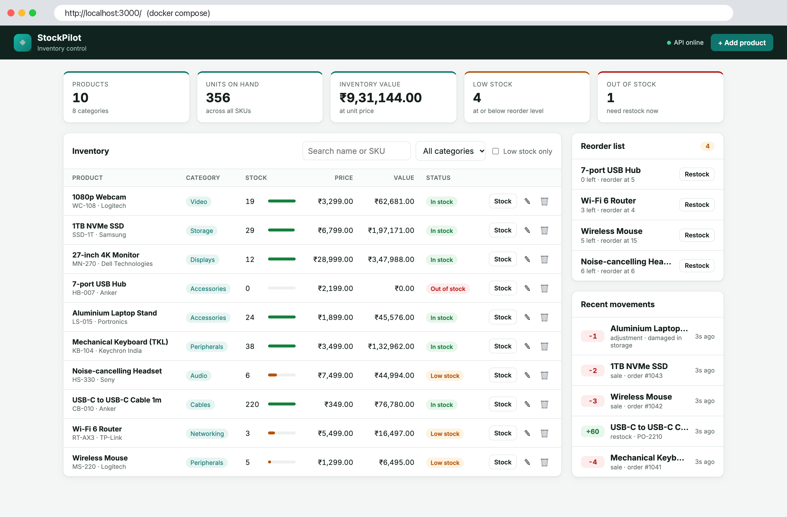

---

## Contents

1. [Architecture](#1-architecture)
2. [The application](#2-the-application)
3. [Run it locally (Docker Compose)](#3-run-it-locally-docker-compose)
4. [Tests](#4-tests)
5. [Docker images](#5-docker-images)
6. [CI/CD pipeline](#6-cicd-pipeline)
7. [Security scanning (Trivy)](#7-security-scanning-trivy)
8. [Terraform: AWS VPC + EKS](#8-terraform-aws-vpc--eks)
9. [Kubernetes + Helm](#9-kubernetes--helm)
10. [Ingress](#10-ingress)
11. [Autoscaling (HPA)](#11-autoscaling-hpa)
12. [Monitoring (Prometheus + Grafana)](#12-monitoring-prometheus--grafana)
13. [Troubleshooting lab](#13-troubleshooting-lab)
14. [Demo script](#14-demo-script)
15. [Rubric map](#15-rubric-map)
16. [Design decisions and trade-offs](#16-design-decisions-and-trade-offs)

---

## 1. Architecture

```text
 Developer ──git push──► GitHub
                           │
                           ▼
              ┌──────── GitHub Actions ─────────┐
              │ 1. test       pytest (13 tests) │
              │               npm ci + build    │
              │    lint-iac   terraform validate│
              │               helm lint         │
              │ 2. build      docker build ×2   │
              │    scan       Trivy HIGH/CRIT ──┼──► fail = nothing is pushed
              │    push       ghcr.io/…:<sha>   │
              │ 3. deploy     helm upgrade      │
              │               --atomic + smoke  │
              └───────────────┬─────────────────┘
                              ▼
   Terraform ──► AWS VPC (2 public + 2 private subnets, NAT) ──► EKS (2× t3.medium)
                              │            (or kind locally / in CI)
                              ▼
 ┌─────────────────────── namespace: stockpilot ───────────────────────┐
 │                                                                     │
 │  Ingress (nginx)   /        ──► Service frontend ──► nginx pods ×2  │
 │  stockpilot.localhost /api,/docs ─► Service backend ──► FastAPI ×2-6│◄── HPA (CPU 60%)
 │                                                    │                │
 │                                    Service postgres ▼               │
 │                                    StatefulSet postgres + PVC       │
 └──────────────────────────────────────────────┬──────────────────────┘
                                                │ /metrics (ServiceMonitor)
 ┌──────────────── namespace: monitoring ───────▼──────┐
 │  Prometheus ── alerts (PrometheusRule)              │
 │  Grafana ── "StockPilot - Application Overview"     │
 └─────────────────────────────────────────────────────┘
```

| Layer | Tech |
|-------|------|
| Frontend | React 19 + Vite 8, plain CSS (responsive), served by unprivileged nginx |
| Backend | FastAPI, SQLAlchemy 2, Pydantic v2, Alembic, Uvicorn |
| Database | PostgreSQL 17 |
| Tests | pytest + FastAPI TestClient, in-memory SQLite |
| Containers | Docker (multi-stage frontend, non-root both), Docker Compose |
| CI/CD | GitHub Actions → GHCR, image tag = commit SHA |
| Security | Trivy (pinned by digest), fails on fixable HIGH/CRITICAL |
| IaC | Terraform: `terraform-aws-modules` VPC + EKS + IRSA |
| Orchestration | Kubernetes (kind locally, EKS on AWS), Helm 3 chart |
| Traffic | ingress-nginx, HPA + metrics-server |
| Observability | kube-prometheus-stack (Prometheus Operator, Prometheus, Grafana), ServiceMonitor, PrometheusRule |

### Repository layout

```text
.
├── backend/                 FastAPI app
│   ├── app/                 main.py (routes), models.py, schemas.py, db.py, config.py
│   ├── alembic/versions/    0001 products, 0002 stock_movements
│   ├── tests/               conftest.py (sqlite fixture) + test_api.py (13 tests)
│   ├── Dockerfile           python:3.13-slim, non-root uid 10001, pip removed
│   └── requirements*.txt    runtime vs test deps split
├── frontend/                React dashboard
│   ├── src/                 main.jsx, styles.css
│   ├── nginx.conf.template  /api proxy, backend host injected at startup
│   └── Dockerfile           node build stage → nginx-unprivileged runtime
├── docker-compose.yml       postgres + backend + frontend
├── .github/workflows/       ci-cd.yml
├── terraform/               VPC + EKS (+ README with apply/destroy steps)
├── k8s/                     namespace.yaml, kind-config.yaml
├── helm/stockpilot/         chart: deployments, services, statefulset, ingress, hpa,
│                            servicemonitor, prometheusrule, grafana dashboard
├── monitoring/              kube-prometheus-stack values + README
├── troubleshooting/         4 broken manifests + runbook
├── scripts/                 kind-up, install-addons, seed, load-test, terraform-localstack
└── docs/screenshots/        evidence for the rubric
```

---

## 2. The application

### Features

- **KPI cards:** product count, units on hand, inventory value (₹), low-stock count, out-of-stock count.
- **Inventory table** with search by name or SKU, a category filter and a "low stock only" toggle. Each row has a stock meter and a status badge.
- **Product CRUD:** add, edit and delete products in a modal. Validation errors come back from the API and are shown inline.
- **Stock movements:** restock, sale or adjustment with a note. Quantity only changes through movements, and a sale that would take stock below zero is rejected.
- **Reorder list:** every product at or below its reorder level, with a one-click "Restock".
- **Recent movements feed:** the audit trail of stock changes.
- **Loading, empty and API-down states.** A live "API online/unreachable" indicator and a retry banner.
- **Responsive:** 5 → 3 → 2 KPI columns, the sidebar stacks under the table, and the table scrolls inside its card on phones.

### REST API

Interactive docs: `http://localhost:8000/docs` (compose) or `http://stockpilot.localhost/docs` (k8s ingress).

| Method | Path | What it does |
|--------|------|--------------|
| GET | `/health` | Liveness: process is up (no DB call) |
| GET | `/ready` | Readiness: runs `SELECT 1` against Postgres, 503 if it fails |
| GET | `/metrics` | Prometheus metrics |
| GET | `/api/products` | List products, `?search=`, `?category=`, `?low_stock=true` |
| GET | `/api/products/{id}` | One product, 404 if missing |
| POST | `/api/products` | Create (201), 409 on duplicate SKU, 422 on bad input |
| PUT | `/api/products/{id}` | Partial update of any field |
| DELETE | `/api/products/{id}` | Delete (204), cascades to its movements |
| POST | `/api/products/{id}/movements` | Record restock/sale/adjustment, row-locked, 400 if stock would go negative |
| GET | `/api/movements` | Latest movements with product names |
| GET | `/api/stats` | Totals, inventory value, low/out-of-stock counts |

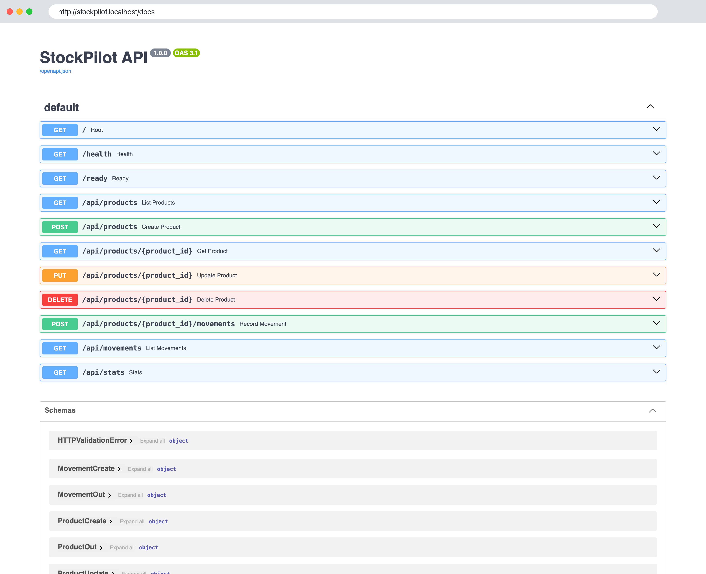

### Data model (Alembic-managed)

```text
products                                stock_movements
──────────────────────────              ─────────────────────────────
id            PK                        id          PK
sku           unique                    product_id  FK → products.id ON DELETE CASCADE
name, category, supplier                change      int (+ in / - out)
quantity      CHECK (quantity >= 0)     reason      RESTOCK | SALE | ADJUSTMENT
reorder_level                           note
unit_price    NUMERIC(10,2)             created_at
created_at, updated_at
```

Two migrations (`0001_create_products`, `0002_create_stock_movements`) show the schema evolving, rather than one big initial dump. The backend container runs `alembic upgrade head` before starting Uvicorn. A Postgres advisory lock in `alembic/env.py` stops replicas from racing each other on the same migration.

---

## 3. Run it locally (Docker Compose)

```bash
docker compose up --build
./scripts/seed.sh                 # optional: 10 demo products + some movements
```

| URL | |
|-----|-|
| http://localhost:3000 | app |
| http://localhost:8000/docs | Swagger UI |
| http://localhost:8000/health · /ready · /metrics | probes + metrics |

```bash
docker compose exec postgres psql -U stockpilot -c 'select sku, name, quantity from products;'
docker compose down        # stop
docker compose down -v     # stop + delete the database volume
```

Postgres has a healthcheck, and the backend waits for `service_healthy`, so migrations never run against a database that isn't up yet. Postgres also isn't published on a host port: only the backend needs it, so nothing else can reach it.

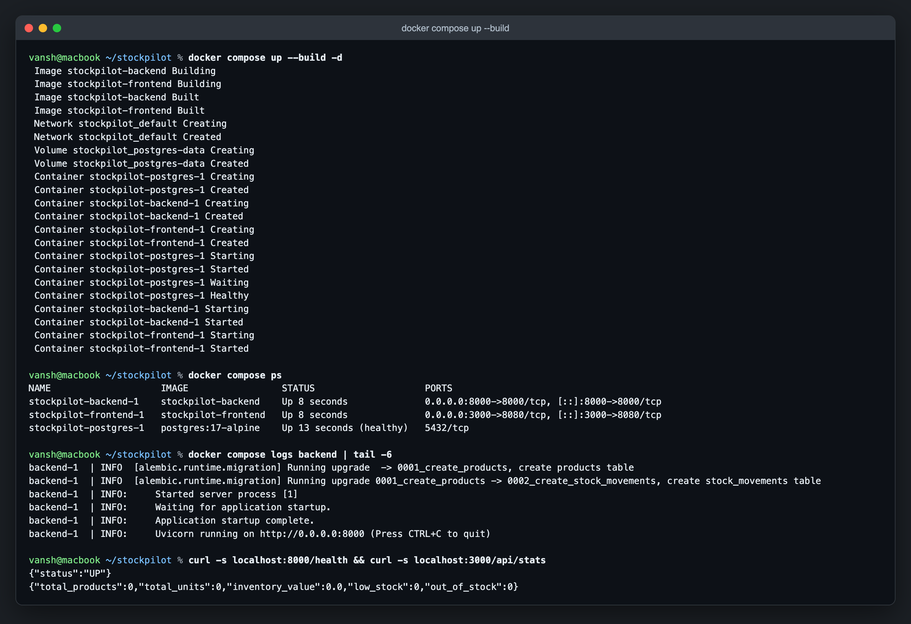

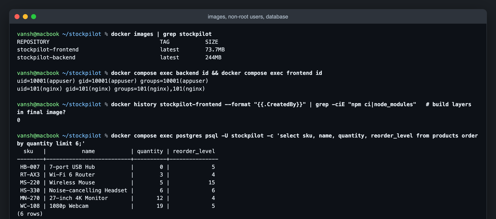

---

## 4. Tests

```bash
cd backend
python -m venv .venv && source .venv/bin/activate
pip install -r requirements-dev.txt
pytest -v
```

The 13 tests cover 11 of the 12 endpoints (all but `/`): health, readiness, metrics, create (happy path, validation, duplicate SKU), list + search, get + 404, update, delete, stock movements, oversell rejection, and stats.

They never touch the real database. `tests/conftest.py` builds a fresh **in-memory SQLite** database for each test and swaps it in through FastAPI's `dependency_overrides[get_db]`, so tests are isolated, fast (~0.1s) and need no Postgres.

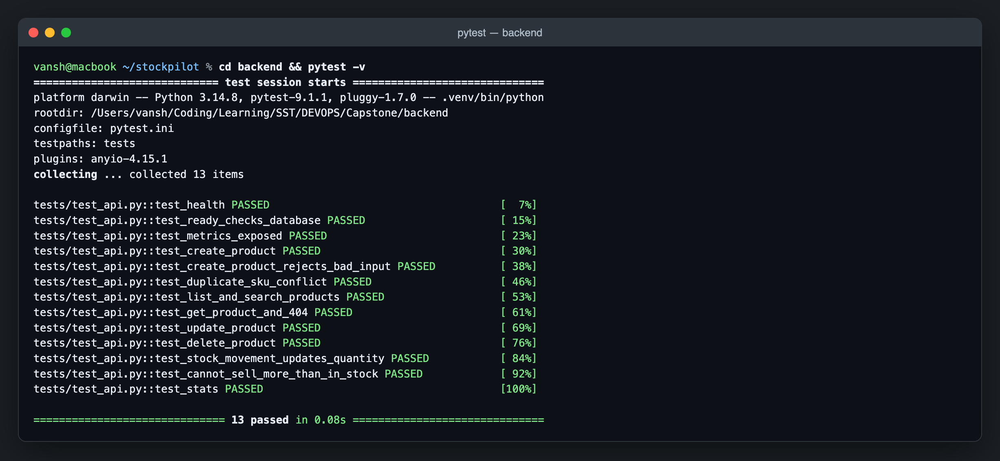

---

## 5. Docker images

| | Backend | Frontend |
|-|---------|----------|
| Base | `python:3.13-slim` | build: `node:22-alpine` → runtime: `nginxinc/nginx-unprivileged:1.29-alpine` |
| User | uid 10001 (`appuser`) | uid 101 (`nginx`) |
| Port | 8000 | 8080 (non-root can't bind 80) |
| Size | ~245 MB | ~75 MB |

- **The frontend uses a multi-stage build.** Node, `node_modules` and the Vite toolchain stay in the build stage, and only the static `dist/` ships.
- **One frontend image works everywhere.** nginx's `/api` proxy target is a template variable (`BACKEND_HOST`), filled in at container start. Compose sets it to `backend`; Helm sets it to `<release>-backend`.
- **Layer order** is requirements, then `pip install`, then code. Code-only changes reuse the cached dependency layer.
- **Startup command:** the backend runs `alembic upgrade head && exec uvicorn …`. `exec` makes Uvicorn PID 1, so it gets the SIGTERM from Kubernetes and shuts down gracefully.

---

## 6. CI/CD pipeline

[`.github/workflows/ci-cd.yml`](.github/workflows/ci-cd.yml) runs on every push and PR to `main`:

```text
          ┌── test ──────────┐   pytest -v (fails build on any failing test)
push ─────┤                  ├──► build-scan-push ──► deploy (main only)
          └── lint-iac ──────┘    docker build ×2      helm upgrade --install --atomic
              terraform fmt/validate   trivy ×2 (gate)    smoke test via the frontend service
              helm lint/template       push to GHCR (:<sha>)
```

- **Quality gates in order.** Nothing gets built if tests fail. Nothing gets pushed if Trivy finds a fixable HIGH or CRITICAL. Nothing gets deployed unless the push succeeded.
- **The image tag is the full commit SHA** (`ghcr.io/vanshchitransh/stockpilot-backend:<sha>`), never `latest`. Every running pod traces back to exactly one commit, and a rollback is `helm rollback`.
- **PRs build and scan but never push.** `deploy` only runs on `main`.
- **Deploy target:**
  - If the repo variable `EKS_CLUSTER_NAME` and the AWS secrets are set, the job deploys to EKS.
  - Otherwise it creates a throwaway kind cluster inside the runner, loads the exact SHA images from GHCR, deploys the same chart and smoke-tests `/healthz` and `/api/stats`. Every commit on `main` is therefore proven to deploy, even when the AWS cluster is torn down to save money.
- **`--atomic`:** if the new pods never become ready, Helm rolls back to the previous release automatically.
- **Least privilege.** Default `contents: read`; only the push job gets `packages: write`.
- `concurrency` cancels superseded runs.

First run, all four jobs green: [actions/runs/38928639839](https://github.com/VanshChitransh/stockpilot-devops-capstone/actions/runs/38928639839). Images: [`stockpilot-backend`](https://github.com/users/VanshChitransh/packages/container/package/stockpilot-backend) and [`stockpilot-frontend`](https://github.com/users/VanshChitransh/packages/container/package/stockpilot-frontend) on GHCR, tagged with the commit SHA.

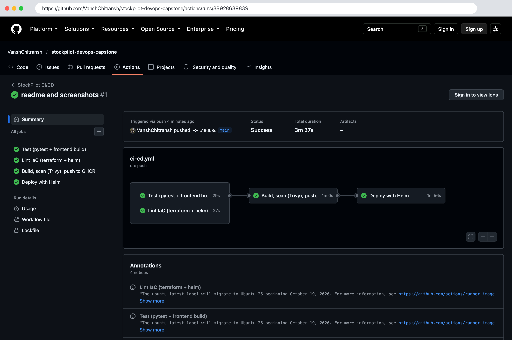

---

## 7. Security scanning (Trivy)

Each image is scanned right after it's built and before it's pushed:

```bash
trivy image --severity HIGH,CRITICAL --ignore-unfixed --exit-code 1 <image>
```

**What Trivy scanned and what it means:** Trivy reads the OS package database inside each image (Debian for the backend, Alpine for the frontend) and every language package (Python `site-packages`, including pip's own vendored libraries). It matches each package version against its vulnerability databases. The gate fails the pipeline on any HIGH or CRITICAL CVE that already has a fixed version (`--ignore-unfixed`), because those are the ones we can act on.

**A real finding from building this project:** the first backend scan failed on four HIGH CVEs, including **CVE-2026-97687** in `urllib3 2.7.0`, which allows HTTPS-proxy traffic interception. None of them were in my dependencies; they were in libraries vendored inside **pip itself**. pip is only needed at build time, so the Dockerfile now runs `pip uninstall -y pip` after installing requirements. The scan is clean, and the image has less in it to attack. The frontend's first scan flagged Alpine packages (`pcre2`, `libxml2`, `libtiff`) whose fixes came out after the base image was built, which `apk upgrade` in the runtime stage fixes.

Other controls in the pipeline and cluster:

| Layer | Control |
|-------|---------|
| Container image | Trivy gate (above), scanner image pinned by digest |
| Runtime | non-root users, `allowPrivilegeEscalation: false`, all Linux capabilities dropped, `seccompProfile: RuntimeDefault`, Pod Security Admission labels on the namespace |
| Secrets | DB credentials in a Kubernetes Secret, `.env`/`*.tfvars`/state gitignored, AWS keys only as GitHub secrets |
| CI | least-privilege `GITHUB_TOKEN` permissions |

Scanners we don't run, and what they would add: SAST (Semgrep, CodeQL) for bugs in our own code; dependency scanning (Dependabot) for PRs on vulnerable pins; secret scanning (gitleaks) for leaked credentials; runtime security (Falco) for suspicious behaviour in running containers.

The same gate in the pipeline (both images clean, exit 0):

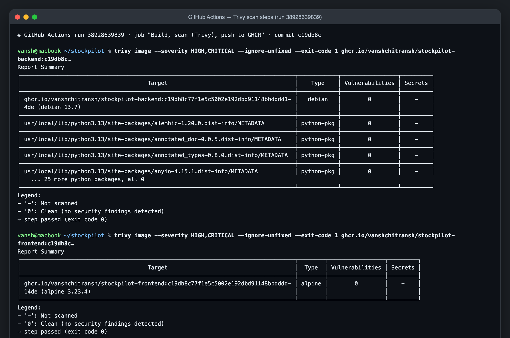

Locally, before and after the pip fix:

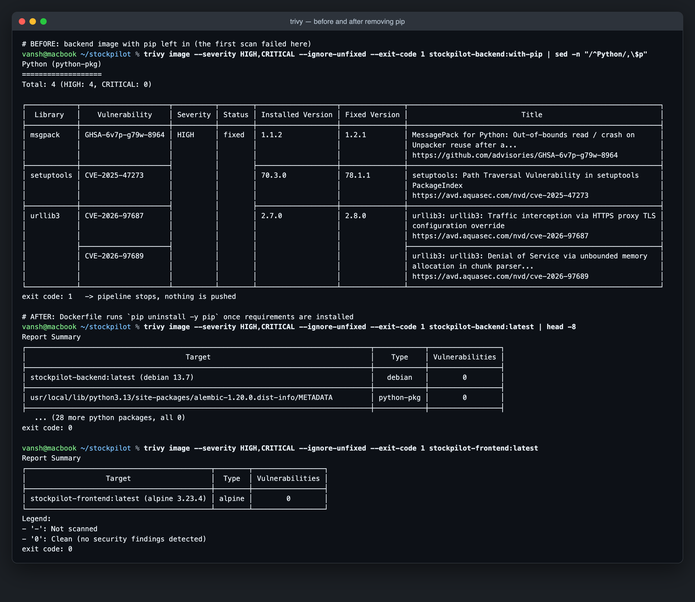

---

## 8. Terraform: AWS VPC + EKS

[`terraform/`](terraform/) provisions, in `ap-south-1`:

- **VPC** `10.30.0.0/16` with **2 public subnets** (load balancers, NAT) and **2 private subnets** (nodes) across 2 AZs, plus 1 NAT gateway.
- **EKS 1.34** with a managed node group of **2 × t3.medium** (autoscaling 2–4).
- **EKS add-ons:** CoreDNS, kube-proxy, VPC CNI, Pod Identity agent, and the EBS CSI driver with its own IRSA role, so the Postgres PVC gets an EBS volume.

```bash
cd terraform
cp terraform.tfvars.example terraform.tfvars
terraform init && terraform plan -out tfplan && terraform apply tfplan
aws eks update-kubeconfig --region ap-south-1 --name stockpilot-eks
../scripts/install-addons.sh eks
# ... demo ...
terraform destroy
```

Full walkthrough, cost estimate (~$6/day) and teardown order: [`terraform/README.md`](terraform/README.md). No credentials are committed: `terraform.tfvars`, state files and `.terraform/` are gitignored, and only `terraform.tfvars.example` is in the repo.

### How it was actually run: LocalStack, no AWS account

I don't have an AWS account, so I ran the **same, unmodified Terraform code** against [LocalStack](https://github.com/localstack/localstack), an AWS API emulator running in Docker. [`scripts/terraform-localstack.sh`](scripts/terraform-localstack.sh) does three things:

- starts the emulator;
- drops in a temporary `*_override.tf` that points the AWS provider at `localhost:4566` with dummy credentials;
- uses a separate `localstack` workspace, so this state can never mix with a real AWS state.

| Step | Result on LocalStack |
|------|----------------------|
| `terraform init` / `validate` / `fmt -check` | ✅ passes (also enforced in CI) |
| `terraform plan` | ✅ **62 resources to add**: the full VPC + EKS + IRSA graph, no errors |
| `apply -target=module.vpc` | ✅ **19 resources**: VPC `10.30.0.0/16`, 2 public + 2 private subnets in `ap-south-1a/b`, IGW, NAT gateway, route tables (verified with `aws ec2 describe-*`) |
| `apply` (EKS module) | ⚠️ creates the 28 supporting resources (IAM roles/policies, KMS key, CloudWatch log group, security groups), then **stops at `CreateCluster`**: EKS isn't emulated in LocalStack's free edition (HTTP 501) |
| `terraform destroy` | ✅ **47 destroyed**; VPCs, IAM roles and state all empty afterwards |

So the network layer is proven end to end, and the EKS module is proven up to the one API call that needs real AWS. The Kubernetes layer itself (Helm, Ingress, HPA, monitoring) is demonstrated on kind (section 9). With an AWS account, the commands at the top of this section run unchanged against real AWS.

```bash
./scripts/terraform-localstack.sh plan
./scripts/terraform-localstack.sh apply -target=module.vpc
./scripts/terraform-localstack.sh aws ec2 describe-subnets --output table
./scripts/terraform-localstack.sh destroy
./scripts/terraform-localstack.sh down
```

| | |
|-|-|
| 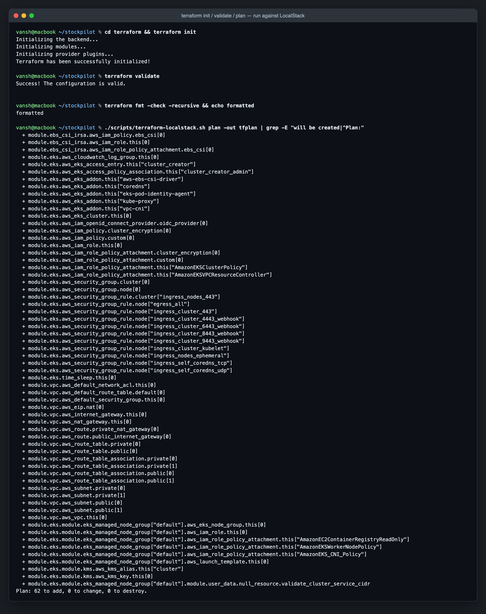 | 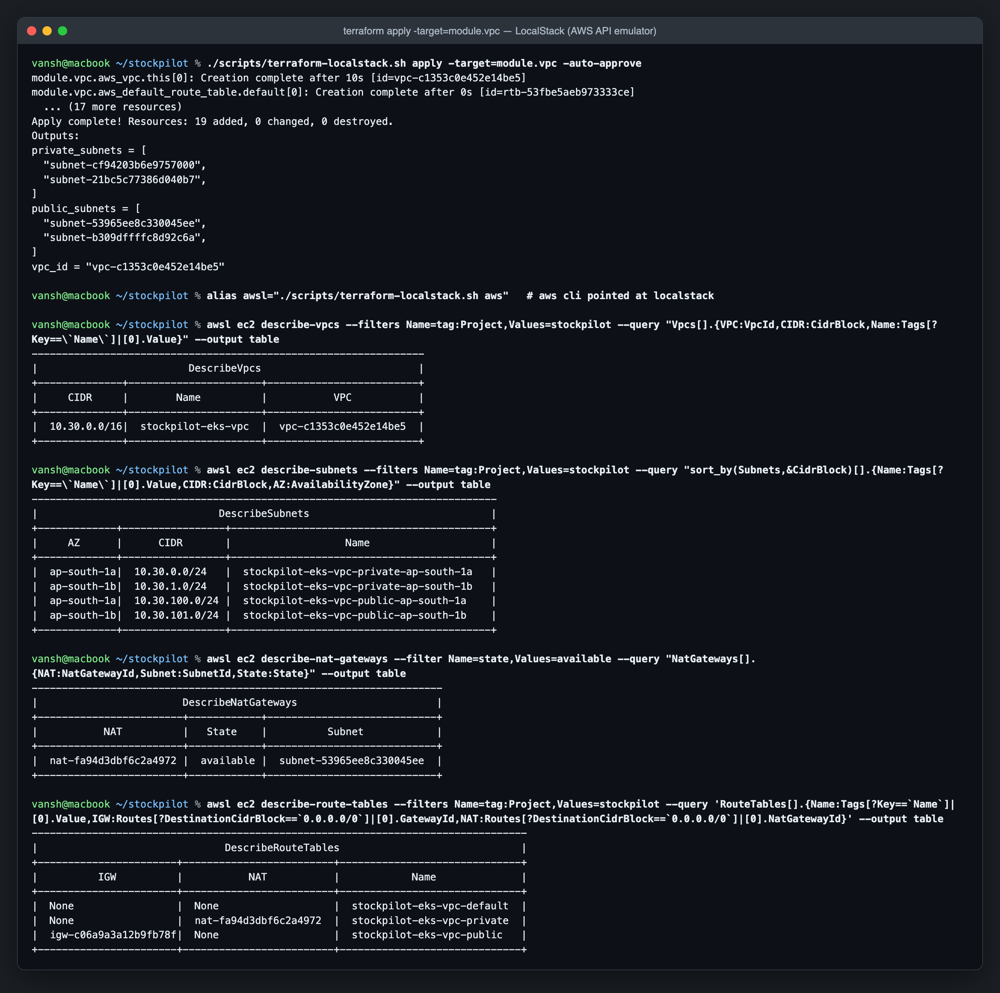 |
| 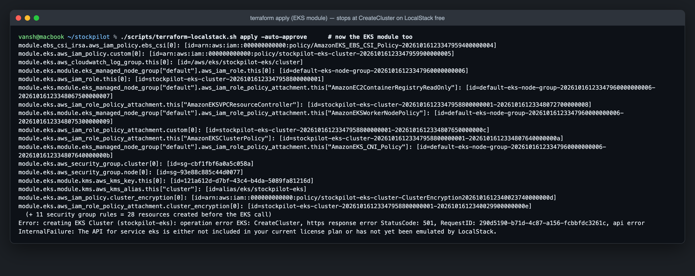 | 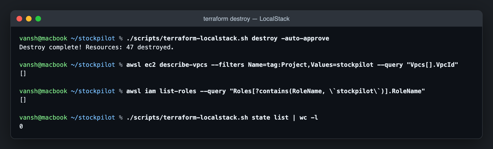 |

---

## 9. Kubernetes + Helm

### One-command local cluster

```bash
./scripts/kind-up.sh
```

This script:

1. Creates a single-node kind cluster.
2. Installs ingress-nginx, metrics-server and kube-prometheus-stack.
3. Builds both images and loads them into the nodes.
4. Runs `helm upgrade --install`.

### Manual steps

```bash
kubectl apply -f k8s/namespace.yaml
helm upgrade --install stockpilot ./helm/stockpilot -n stockpilot -f helm/stockpilot/values-dev.yaml
kubectl get pods,svc,ingress,hpa -n stockpilot
helm list -n stockpilot
helm history stockpilot -n stockpilot
helm rollback stockpilot <revision> -n stockpilot
```

### What the chart creates

| Resource | Notes |
|----------|-------|
| `Deployment` backend | 2+ replicas (HPA-owned), rolling update `maxUnavailable: 0`. Probes: startup + liveness on `/health`, readiness on `/ready`. Init container waits for Postgres. Non-root, all capabilities dropped |
| `Deployment` frontend | 2 replicas, probes on nginx `/healthz` |
| `StatefulSet` postgres | 1 replica + `volumeClaimTemplate`, so data survives pod restarts |
| `Service` ×3 | all `ClusterIP`; only the Ingress is exposed |
| `Secret` | DB user/password + full `DATABASE_URL`; the pod template carries a checksum, so changing it rolls the pods |
| `Ingress` | `/api`, `/docs`, `/openapi.json` → backend, `/` → frontend |
| `HorizontalPodAutoscaler` | backend, 2–6 replicas at 60% CPU |
| `ServiceMonitor`, `PrometheusRule` | only rendered if the Prometheus Operator CRDs exist (`.Capabilities.APIVersions.Has`), so the chart still installs on a bare cluster |
| `ConfigMap` grafana dashboard | auto-imported by Grafana's sidecar |

Three values files cover the environments:

- `values.yaml`: defaults (GHCR images).
- `values-dev.yaml`: kind; local images, `pullPolicy: Never`.
- `values-prod.yaml`: EKS; bigger PVC, HPA up to 8.

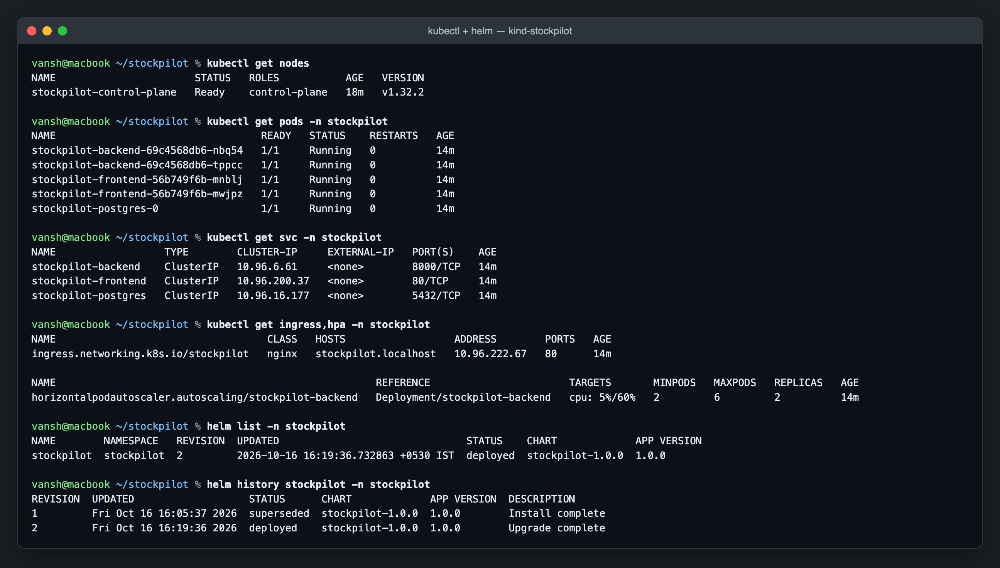

---

## 10. Ingress

```text
http://stockpilot.localhost/        → stockpilot-frontend:80 → nginx → React app
http://stockpilot.localhost/api/... → stockpilot-backend:8000 → FastAPI
http://stockpilot.localhost/docs    → stockpilot-backend:8000 → Swagger UI
http://grafana.localhost/           → monitoring-grafana:80
```

An Ingress resource is only routing rules. The **ingress-nginx controller** is what actually listens on ports 80/443 and implements them. On kind, the controller binds the node's host ports (mapped to the laptop in `k8s/kind-config.yaml`). On EKS, it gets an AWS load balancer instead. `*.localhost` resolves to 127.0.0.1 in browsers and curl, so no `/etc/hosts` editing is needed.

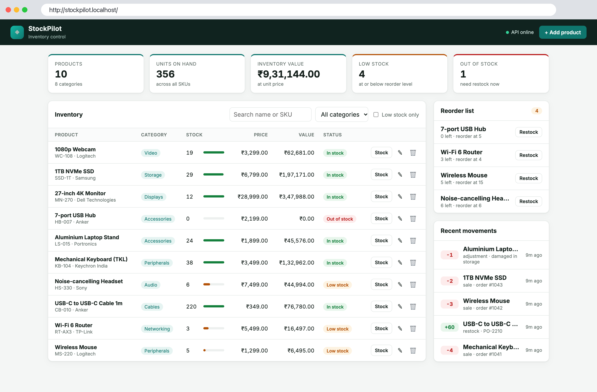

---

## 11. Autoscaling (HPA)

```bash
kubectl get hpa -n stockpilot -w           # terminal 1
./scripts/load-test.sh                     # terminal 2: 8 in-cluster workers for 3 min
```

The HPA measures CPU as **a percentage of the pod's CPU request** (100m), which is why the Deployment must declare requests. metrics-server supplies the numbers. Under load the backend went from 2 to 6 replicas, and scaled back down to 2 after the load stopped (scale-down stabilization is shortened to 60s for the demo).

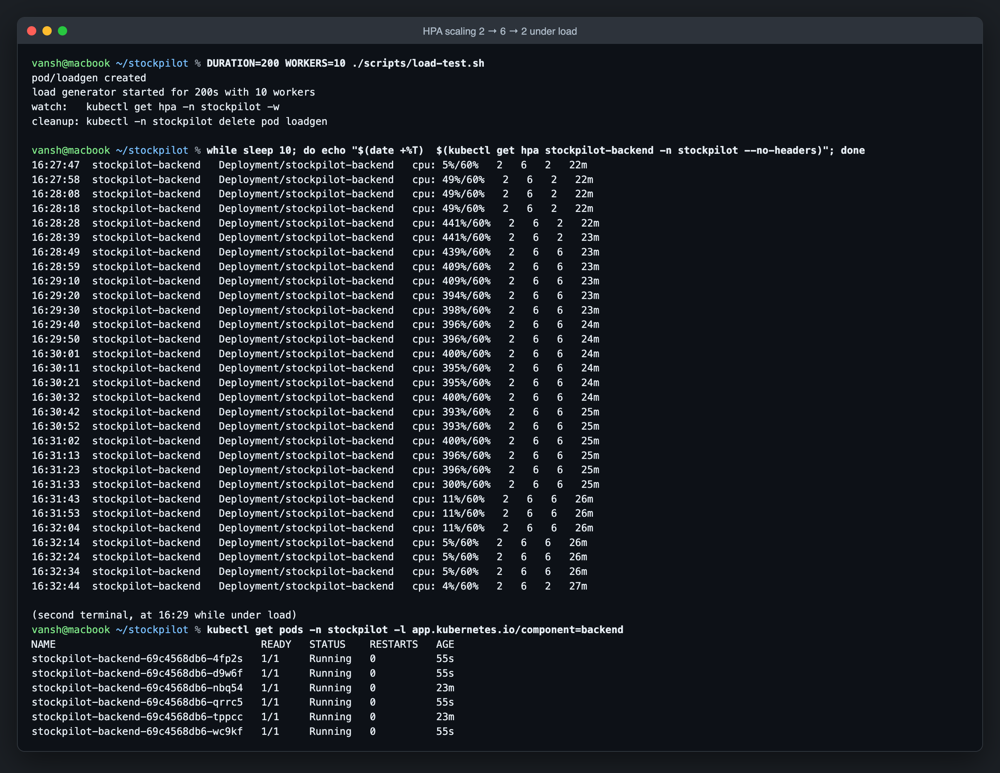

---

## 12. Monitoring (Prometheus + Grafana)

- The backend exposes `/metrics` through `prometheus-fastapi-instrumentator`, plus a custom business metric: `stockpilot_stock_movements_total{reason}`.
- The chart's **ServiceMonitor** tells the Prometheus Operator to scrape it every 15s.
- The **PrometheusRule** defines 3 alerts: backend down, error rate above 5%, and p95 latency above 1s.
- The **Grafana dashboard** ships as a ConfigMap. Its panels:
  - requests/s, p95 latency, 5xx rate and ready pods
  - request rate per endpoint
  - p50/p95/p99 latency
  - status classes
  - stock movements by reason
  - CPU per pod vs request
  - HPA current vs desired replicas

Details and PromQL: [`monitoring/README.md`](monitoring/README.md).

| | |
|-|-|
| 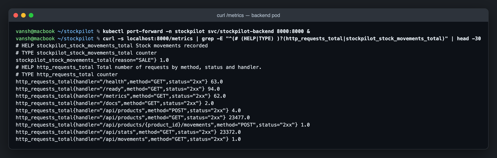 | 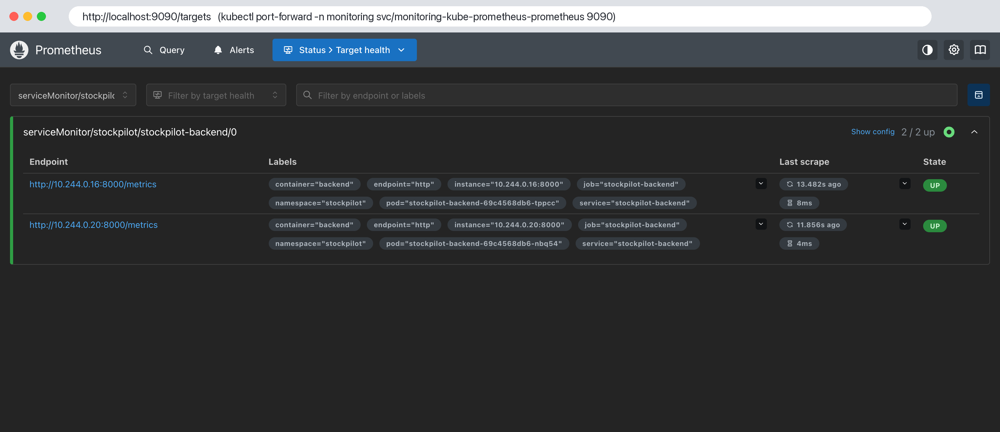 |

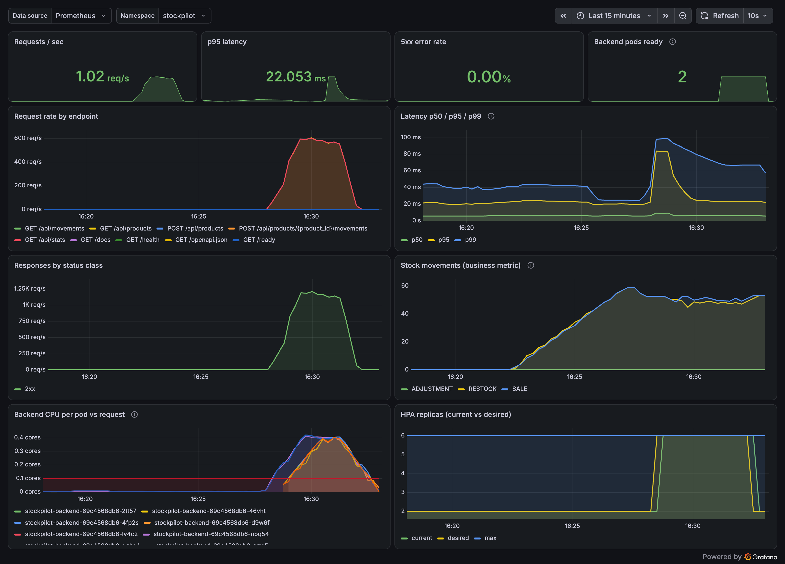

---

## 13. Troubleshooting lab

[`troubleshooting/`](troubleshooting/) has four deliberately broken manifests, each with a runbook entry (symptom → commands → root cause → fix) and the real output from the cluster:

| # | Break | What you see | Lesson |
|---|-------|--------------|--------|
| 1 | wrong image tag | `ErrImagePull` / `ImagePullBackOff` | `describe pod` → Events tells you exactly why |
| 2 | Service selector typo | Service exists, `ENDPOINTS <none>` | Services find pods by labels only |
| 3 | wrong DB hostname | `CrashLoopBackOff`, restarts climbing | `logs --previous` shows the crash of the last attempt |
| 4 | readiness path typo | `Running` but `0/1` Ready, no traffic | Running ≠ Ready; readiness gates Service endpoints |


---

## 14. Demo script

| # | Show | Command / place |
|---|------|-----------------|
| 1 | App | http://stockpilot.localhost: add a product, record a sale, watch the KPIs update |
| 2 | API | http://stockpilot.localhost/docs: run CRUD from Swagger |
| 3 | Database | `kubectl exec -n stockpilot stockpilot-postgres-0 -- psql -U stockpilot -c 'select * from stock_movements;'` |
| 4 | Git | change something small (e.g. the subtitle under "StockPilot" in `frontend/src/main.jsx`), commit, push |
| 5 | CI | Actions tab: test → lint-iac → build-scan-push → deploy |
| 6 | Docker / Trivy | the build and scan steps in the run log |
| 7 | Registry | GitHub profile → Packages → `stockpilot-backend` / `-frontend`, SHA tags |
| 8 | Terraform | `terraform/` code + plan output + AWS console (VPC, EKS) |
| 9 | Kubernetes | `kubectl get pods,svc -n stockpilot` |
| 10 | Helm | `helm list -n stockpilot`, `helm history stockpilot -n stockpilot` |
| 11 | Ingress | open the app at the ingress hostname |
| 12 | HPA | `./scripts/load-test.sh` + `kubectl get hpa -n stockpilot -w` |
| 13 | Monitoring | Grafana dashboard + Prometheus targets page |
| 14 | Failure | `kubectl apply -f troubleshooting/02-broken-service.yaml`, then debug it live |

---

## 15. Rubric map

| Module | Where |
|--------|-------|
| M1 Application | `backend/app/`, `backend/alembic/versions/`, `frontend/src/`, `docker-compose.yml` · screenshot 01 |
| M2 Testing | `backend/tests/`, `backend/pytest.ini` · screenshot 02 |
| M3 Git | commit history, `.gitignore` |
| M4 Docker | `backend/Dockerfile`, `frontend/Dockerfile` (multi-stage), non-root users, `docker-compose.yml` · screenshots 03, 04 |
| M5 CI/CD | `.github/workflows/ci-cd.yml` · [Actions run](https://github.com/VanshChitransh/stockpilot-devops-capstone/actions/runs/38928639839) · GHCR packages · screenshot 05 |
| M6 Trivy | scan steps in the workflow, [section 7](#7-security-scanning-trivy) explanation · screenshots 06, 23 |
| M7 Terraform | `terraform/*.tf`, `terraform.tfvars.example`, `terraform/README.md`, run via LocalStack ([section 8](#8-terraform-aws-vpc--eks)) · screenshots 19–22 |
| M8 Kubernetes + Helm | `k8s/`, `helm/stockpilot/` · screenshots 07, 08 |
| M9 Observability | `/metrics`, `monitoring/`, ServiceMonitor, dashboard · screenshots 10–12 |
| M10 Docs + demo | this README, [section 14](#14-demo-script) |

---

## 16. Design decisions and trade-offs

- **Postgres in-cluster vs RDS.** A StatefulSet keeps the project self-contained and free to run on kind. In production I'd use RDS (managed backups, Multi-AZ failover, patching) and delete `postgres.yaml`. The app only needs a different `DATABASE_URL`.
- **Migrations on container start.** This is simple and always in sync with the code, and the advisory lock makes it safe with several replicas. The production-grade alternative is a dedicated migration Job (a Helm hook, or a pipeline step) so a bad migration fails the deploy before any pod rolls.
- **The HPA scales on CPU only.** That's simple and built in. Request-rate scaling (through prometheus-adapter or KEDA) would track load more directly for an I/O-bound API.
- **Single NAT gateway** saves about $1.30/day per AZ. The cost is that an AZ outage cuts egress for the private subnets.
- **The kind deploy in CI** proves the chart and images work together on every commit at zero AWS cost. It is not a long-lived environment, and that's what the EKS path is for.
- **Client-side filtering in the UI.** It's instant for hundreds of SKUs. Past a few thousand, switch to the API's `?search=` and paginate.
