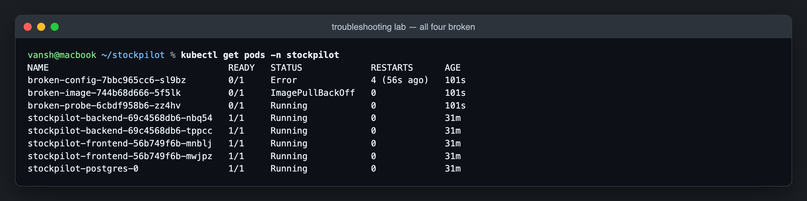
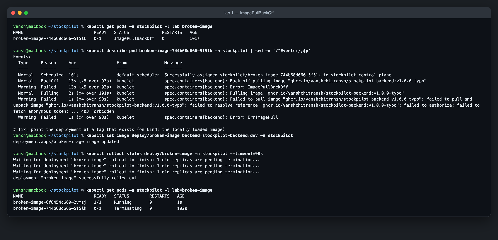
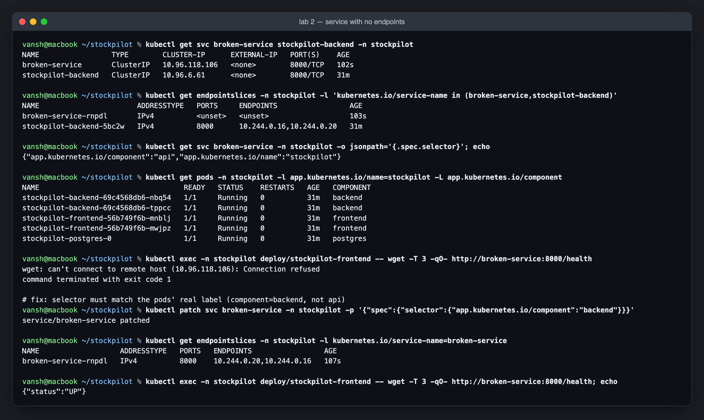
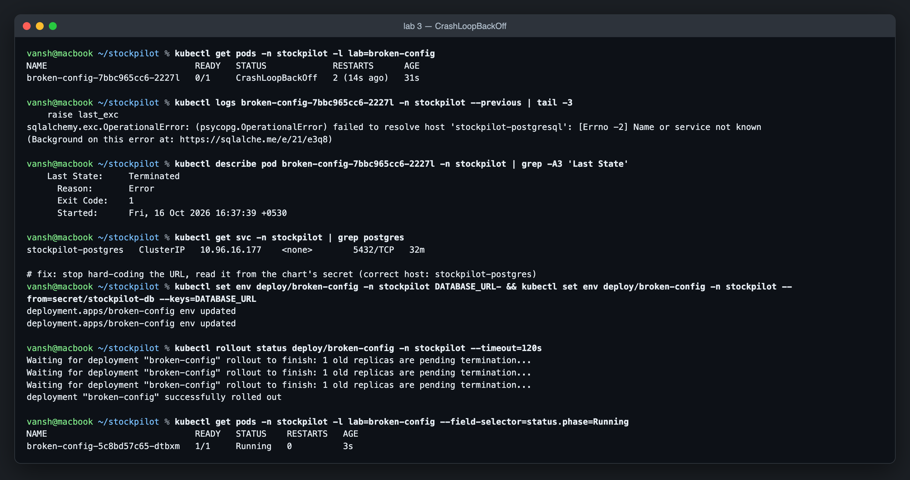
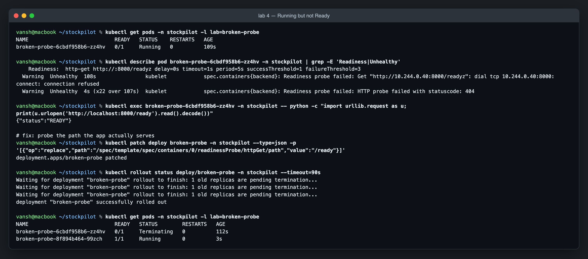

# Troubleshooting lab

Four manifests, each broken in one specific way. Apply them next to the running app and debug them like a real incident:

```bash
kubectl apply -f troubleshooting/          # break everything
kubectl get pods -n stockpilot             # what does "broken" look like?
# ...investigate + fix each one (below)...
kubectl delete -f troubleshooting/         # clean up
```



The general loop is the same every time:

```text
kubectl get        → what state is it in?          (STATUS, READY, RESTARTS, ENDPOINTS)
kubectl describe   → what did Kubernetes try?      (Events at the bottom)
kubectl logs       → what did the app say?         (--previous for the crashed attempt)
compare            → what does a working one look like? (labels, env, probe paths)
fix, roll out, verify
```

---

## 1. `ImagePullBackOff`: image tag doesn't exist

**Manifest:** [`01-broken-image.yaml`](01-broken-image.yaml) uses `stockpilot-backend:v1.0.0-typo`.

| | |
|-|-|
| Symptom | `STATUS ErrImagePull` → `ImagePullBackOff`, `READY 0/1`, restarts stay at 0 (the container never started) |
| Investigate | `kubectl describe pod <pod>`: the Events show the kubelet's pull attempts and the registry's answer |
| Root cause | the image reference doesn't resolve to anything pullable. GHCR answers an anonymous pull for a package/tag it can't serve with `403 Forbidden` (that's what's captured here). Other registries say `not found` for a bad tag, and `unauthorized` when the image exists but is private and no pull secret is set |
| Fix | `kubectl set image deploy/broken-image backend=<image>:<real tag>` (in this project: the commit SHA from CI). For private packages, also add an `imagePullSecret` |
| Prevent | never deploy hand-typed tags: CI passes `--set backend.tag=$GITHUB_SHA`, which is guaranteed to exist because the same pipeline just pushed it |

"BackOff" means the kubelet waits longer between attempts each time (10s, 20s, 40s … up to 5 min), so a fixed registry isn't noticed instantly. Changing the spec triggers a fresh pod.



---

## 2. Service with no endpoints: selector doesn't match

**Manifest:** [`02-broken-service.yaml`](02-broken-service.yaml) selects `app.kubernetes.io/component: api`.

| | |
|-|-|
| Symptom | Service exists and has a ClusterIP, the pods are Running and Ready, but calls fail: `Connection refused` |
| Investigate | `kubectl get endpointslices -l kubernetes.io/service-name=broken-service` shows `ENDPOINTS <unset>`. Compare `kubectl get svc -o jsonpath='{.spec.selector}'` with `kubectl get pods -L app.kubernetes.io/component` |
| Root cause | a Service doesn't point at Deployments or names, it **selects pods by labels**. Nothing is labelled `component=api` (the backend is `component=backend`), so the endpoint list is empty and kube-proxy rejects the connection |
| Fix | `kubectl patch svc broken-service -p '{"spec":{"selector":{"app.kubernetes.io/component":"backend"}}}'`, and endpoints appear within seconds |
| Prevent | the Helm chart builds Service selectors and pod labels from the same `stockpilot.selector` helper, so they can't drift apart |

"Connection refused" (nothing behind the IP) is different from a timeout (packets dropped, e.g. a NetworkPolicy) and from `Could not resolve host` (wrong Service name or namespace). Knowing which one you got narrows the search a lot.



---

## 3. `CrashLoopBackOff`: bad configuration

**Manifest:** [`03-broken-config.yaml`](03-broken-config.yaml) sets `DATABASE_URL=...@stockpilot-postgresql:5432/...`.

| | |
|-|-|
| Symptom | `Running` → `Error` → `CrashLoopBackOff`, RESTARTS keeps climbing |
| Investigate | `kubectl logs <pod> --previous`: the *current* container may have just restarted and have no logs yet, while `--previous` shows the attempt that died. `describe` shows `Last State: Terminated, Exit Code: 1` |
| Root cause | the log says `failed to resolve host 'stockpilot-postgresql'`. The Service is called `stockpilot-postgres`. Alembic can't connect, exits 1, and Kubernetes restarts it with growing back-off |
| Fix | take the URL from the chart's Secret instead of hard-coding it: `kubectl set env deploy/broken-config --from=secret/stockpilot-db --keys=DATABASE_URL` |
| Prevent | config comes from one place (the Helm-managed Secret), and the real backend has an init container that waits for Postgres, so a slow DB start isn't mistaken for this |

Exit code tells you a lot: `1` = app error (read the logs), `137` = killed by SIGKILL (usually OOMKilled, check `describe` → `Reason`), `143` = SIGTERM (normal shutdown).



---

## 4. Running but never Ready: wrong readiness probe

**Manifest:** [`04-broken-probe.yaml`](04-broken-probe.yaml) probes `/readyz`.

| | |
|-|-|
| Symptom | `STATUS Running`, `READY 0/1` forever, no restarts. The pod never receives Service traffic |
| Investigate | `describe` → Events: `Readiness probe failed: HTTP probe failed with statuscode: 404`. `kubectl exec` into the pod and hit `/ready` yourself: it answers `{"status":"READY"}` |
| Root cause | the app is healthy, the probe is asking the wrong question. The app serves `/ready`, not `/readyz` |
| Fix | `kubectl patch deploy broken-probe --type=json -p '[{"op":"replace","path":"/spec/template/spec/containers/0/readinessProbe/httpGet/path","value":"/ready"}]'` |
| Prevent | probe paths live in the chart template next to the app they belong to, and CI's kind deploy runs with `--wait`, so a never-ready pod fails the pipeline |

Readiness and liveness answer different questions:

- **Readiness** ("send me traffic?") failing removes the pod from Service endpoints. Nothing restarts.
- **Liveness** ("am I stuck?") failing **restarts** the container.

The same typo in a liveness probe would turn this into a restart loop. That's why StockPilot's liveness probe uses the dependency-free `/health`: a database outage should take pods out of rotation, not restart all of them.


